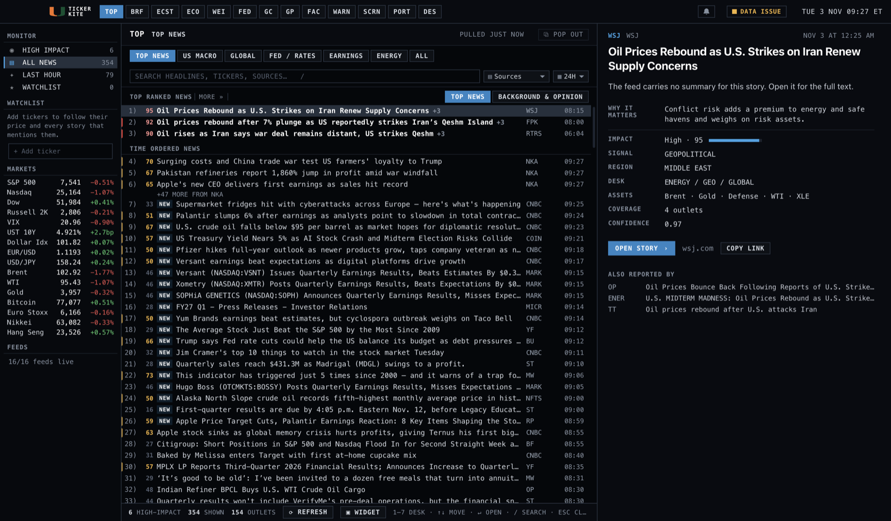
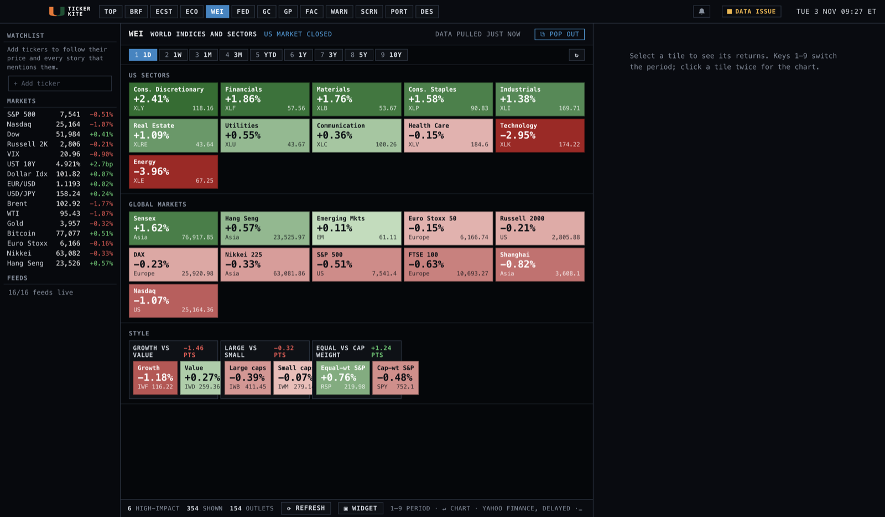
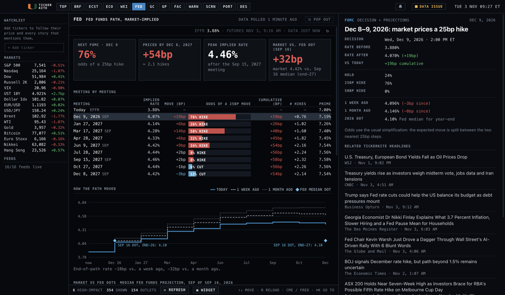

# Tickerkite — Market News Terminal for Mac

A desktop news terminal that pulls headlines from about 17 live sources every 2 minutes, merges the same story reported by different outlets, and ranks what is most likely to move markets. Delayed quotes for indices, yields, FX, oil, gold and bitcoin sit in the sidebar. Free sources only, no API keys.



| Markets heatmap | Fed path |
| --- | --- |
|  |  |

> **Source-visible, not open source.** The code is public so you can read it. No license is granted to copy, modify, redistribute or sell it; all rights are reserved.

## Run it

You need Node.js 20 or newer. Check with `node -v`; if it's missing, install the LTS from https://nodejs.org.

```bash
cd tickerkite
npm install      # downloads Electron (~100 MB, first time only)
npm start
```

The first pull takes about 10 seconds. After that the app opens instantly from its cache.

### Updating

When a newer version is on GitHub, an **UPDATE AVAILABLE** button appears in the top bar (Tickerkite checks at launch and every 6 hours; **Tickerkite › Check for Updates…** checks now). Click it and confirm: the app downloads the new code, replaces its own files, reinstalls packages only if they changed, and restarts. Your watchlist, notes and settings stay (they live in the app's data folder, not the code folder). A copy cloned with git updates with `git pull` instead; a built `.app` can't rewrite itself, so its button opens this page to rebuild. The check reads `version` in package.json on the `main` branch, so **an update goes out to everyone when `version` is bumped and pushed.**

### Build a real .app / .dmg

```bash
npm run dist
```

The installer lands in `dist/`. Without an Apple Developer ID certificate the build is unsigned, so the first time you open it, right-click **Tickerkite.app → Open → Open**. See *Selling Tickerkite* below to sign and notarize it.

## Using it

### Themes

Tickerkite opens in the **Terminal** theme: near-black background, cyan accents, monospace uppercase labels and square tiles. Across the top is a row of function codes, one per page, with the New York time on the right:

| Code | Page | Shortcut |
|---|---|---|
| TOP | News | ⌘⌥1 |
| BRF | Brief | ⌘⌥0 |
| ECST | Scorecards (outlook, decile board, recession odds) | ⌘⌥2 |
| ECO | Calendar | ⌘⌥3 |
| WEI | Markets heatmap | ⌘⌥4 |
| MAP | Sector map (sectors that open into their companies, 2D or 3D) | ⌥H |
| FX | Currencies (megatrends and a two-currency compare) | ⌘⌥X |
| MA | Mergers and acquisitions (deals for US-listed targets, filters and market charts) | ⌥Q |
| FED | Fed path | ⌘⌥5 |
| GC | Yield curve | ⌘⌥8 |
| GP | Graphs | ⌘⌥6 |
| PORT | Portfolio | ⌘⌥7 |
| DES | Company | ⌘⌥9 |
| MC | Portfolio Monte Carlo (10,000 simulated futures against a benchmark) | ⌥O |

Each page has a header strip (code, title and status on the left, **PULLED N MINUTES AGO** on the right) and a footer with its keys. The same codes work in the ⌘K bar. The older slate/indigo look is still there as **Classic**: switch with **View › Switch Theme** (⌘⌥T) or **Settings › Appearance**. The choice is remembered on this Mac. In Classic, the top bar works as described next.

The top bar has six entries: **Brief · News · Portfolio · Markets ▾ · Macro ▾ · Company**. **Markets ▾** opens Markets, Yield curve, Fed path and Graphs; **Macro ▾** opens Scorecards and Calendar. A group shows the page you're on. The ⌘⌥0–9 shortcuts, the ⌘K command bar and reopening on your last page work as before. While a page loads it shows placeholder rows, and a failed download says so with a **Try again** button.

| Key | Action |
|---|---|
| `↑` `↓` or `j` `k` | Move through headlines |
| `Enter` or `o`, or double-click | Open the story in your browser |
| `1`–`7` | Top News, US Macro, Global, Fed / Rates, Earnings, Energy, All |
| `/` | Search (headlines, tickers, outlets, regions) |
| `Esc` | Clear search and source filter |
| `⌘R` | Refresh now |

- **Top Ranked News** shows the 3 highest-impact stories in the current filter. Click *More »* to show 10.
- **Time Ordered News** lists everything newest first. `+2` means two more outlets carry the same story; the story pane lists them under *Also reported by*. When one outlet posts a batch back to back, the list shows its first 3 and folds the rest under **+N more from NKA**; click it to show them.
- **Background & Opinion** switches to analysis, previews and columns.
- Each row shows its **impact score** (0–100) before the headline, red for high and amber for medium, with a matching bar on the row's left edge. **NEW** marks stories published in the last 30 minutes that you haven't opened. Feed items with no publish time are dated when Tickerkite first sees them and never get NEW.
- The story pane shows the publisher's site (e.g. `nikkei.com`) instead of the raw link; **Open story** opens it, and **Copy link** copies the full URL (hover either to see it).
- On the News page the sidebar's **Monitor** block filters to High Impact, Last Hour or Watchlist stories; it's hidden on other pages. The watchlist and markets lists stay on every page.
- High-impact headlines trigger a macOS notification. Turn this off under **View › Alerts for High-Impact Headlines**.

## Watchlist

Type a ticker into **+ add ticker** in the sidebar and press Enter. Any Yahoo Finance symbol works: `NVDA`, `BRK-B`, `7203.T`, `ASML.AS`. Tickerkite checks the symbol exists and looks up the company name.

- Each ticker shows its price, day change and sparkline. Click it for the full chart, momentum and "what moved it", the same as the markets below it. Hover and click **×**, or select it and press Delete, to remove it.
- Stories that mention your tickers get a green **★ NVDA** tag. **Watchlist** in the sidebar shows only those stories.
- A story counts as a mention when it uses the ticker in capitals (`NVDA`, `$NVDA`) or the company's short name ("Nvidia"). One- and two-letter tickers only count as `$F` or `(F)`, so "F-35" isn't a Ford story.
- A new story about one of your tickers sends a notification whatever its impact score. Turn this off under **View › Alerts for Watchlist Headlines**.
- For US stocks, the ticker's view also shows a **Company** section under the key numbers:
  - **Next earnings date**, from Nasdaq. The label says whether the date is confirmed or a Zacks estimate. When Nasdaq has no future date, Tickerkite estimates it from the company's past filing dates and labels it **ESTIMATED**.
  - **Valuation**: market cap, P/E (delayed price ÷ trailing-twelve-month diluted EPS) and price/sales, plus where today's P/E sits in its 5-year range.
  - **Fundamentals**: TTM revenue, net income, EPS, gross and operating margin, cash, total debt and shares outstanding.
  - **The last 8 quarters**.
- **Notes** tab (key 7): your own free-text note per ticker, private to this Mac, saved as you type in `company-notes.json`; the Overview shows it under "Your note".
- Fundamentals come from SEC EDGAR 10-Q/10-K filings (free, no key). Tickerkite caches them for 24 hours in `company-cache.json`.
  - The fourth quarter only appears inside the annual report, so it's worked out as the annual figure minus the first nine months, marked `*`.
  - Per-share figures are adjusted for stock splits.
- The SEC asks apps to send a contact email with each request. The first time you open a stock, the section asks for one. Tickerkite sends it only to sec.gov and saves it in `prefs.json` (`secContact`).
- ETFs, crypto, futures and non-US stocks show "No SEC filings for this symbol" instead of the Company section.
- **View › Edit Watchlist…** opens `watchlist.json`. Edit `terms` to change which words count as a mention, for example `["Nvidia", "Jensen Huang"]` or, for Target, `["Target Corp"]` so "inflation target" doesn't match. Tickerkite picks up the change as soon as you save.

## Scorecards

Choose **Macro › Scorecards** at the top (or ⌘⌥2; ⌘⌥1 goes back to News). Each tab scores one asset class from 0 to 100 for the next 6–12 months: **Stocks, Bonds, Commodities, Real Estate, Crypto, Alts** (gold and precious metals). 50 is neutral; higher means conditions are more supportive of that asset. Keys `1`–`6` switch tabs, `↑` `↓` move through indicators.

- **53 indicators in 8 sections:** Growth, Inflation, Labor, Rates & Fed, Credit & Conditions, Consumer & Housing, Markets and Global. Data comes from the St. Louis Fed (FRED, no key needed) and Yahoo Finance, refreshed every 6 hours or with **UPDATE DATA**.
- **Each row** shows the latest reading, where it was 6 months ago, its trend, where it sits in its own history, and how many points it adds to or takes from the selected score.
- **Pushing up / pulling down** lists the biggest drivers of the score.
- **What changed** explains a score move: the total change over the last week (**1W**) or month (**1M**) and the indicators that moved it most, with each one's value then → now and the points it added or took away. Click one to open it. Rows in the main table tagged **NEW** got a fresh data point in the last 7 days.
- **Vs the average of all six** ranks the assets against each other. Even when everything scores low, it shows which are least and most exposed.
- **Regime** plots growth against inflation (Goldilocks, Reflation, Slowdown, Stagflation) from the direction of the last 6 months. Click the box for the **regime path** in the right pane: where growth and inflation were heading at each of the last 24 month-ends, drawn as one line across the four quarters that brightens toward today. It plays once when opened; **REPLAY** runs it again, and clicking a month on the strip underneath jumps to it. Past months use today's revised data.
- **Inflation mode** shows how far the weights have shifted for an inflation-driven market (below).
- **Click any indicator** for its history with recessions shaded, and its effect on all six outlooks. Market indicators link to the full price chart.

### How the score is built

1. Every indicator gets a **level** reading (where today sits in the last 10 years) and a **trend** reading (how its 6-month change compares with past 6-month changes). Both run from −1 to +1 and are mixed 35% level / 65% trend.
2. Every indicator feeds one **factor**: growth, inflation, labor, yields, Fed policy, credit, financial conditions, dollar, market stress, consumer, global, or the asset's own price trend.
3. Each asset weights each factor from −2 to +2. Rising inflation is −1 for stocks, −2 for bonds and +2 for commodities, for example. A factor's weight is split across its indicators, so inflation having 7 indicators doesn't make it count 7 times.
4. The weighted average is stretched (×1.5) and mapped to 0–100.
5. **Inflation mode.** Stocks and bonds usually move apart: bad news means rate cuts, so bonds rally. When inflation is the main worry (the 1970s, 2022), bad news means higher rates and both fall together. Tickerkite measures inflation pressure from the inflation indicators and blends toward a second set of weights, `inflationary`, as it rises. In that set, bonds lose their credit as a hedge and inflation and rising yields hurt stocks and bonds more. `inflationMode.center` and `width` set where the switch happens. To turn it off, set `"inflationary": {}`.

Tune everything in **View › Edit Scorecard Weights…** (`scorecard-weights.json`). Tickerkite recalculates as soon as you save. **Reset Scorecard Weights to Defaults** undoes your changes. The math is in `src/macro/score.js` and the indicator list in `src/macro/indicators.js`.

### Backtest

`node scripts/backtest.js` downloads about 30 years of data, scores every month since 2007, and compares each score with that asset's return over the following 12 months (SPY, IEF, DBC, VNQ, BTC, GLD with dividends). Add `--cache file.json` to reuse the download. It also prints the scores at turning points (2008, 2020, 2022) and runs an experimental contrarian weighting.

What it showed (October 2026):

- Higher scores were followed by better returns for stocks, bonds, commodities and real estate on average, but the link is weak: correlations of 0.05–0.2. Crypto and gold showed none.
- Inflation mode improved bonds (0.15 → 0.19) and the relative ranking (top minus bottom asset +0.6% → +3.7% a year), and got bonds right in 2021–22.
- **The scorecard is most bearish near market bottoms** (November 2008, April 2020, June 2022), when conditions look worst but prices have already fallen. Treat very low scores as "conditions are bad", not "sell".

It uses today's revised data and overlapping 12-month windows, so treat it as a sanity check, not proof.

**Limits:** free data only. There are no consensus forecasts, so the scorecard can't show "CPI came in hotter than expected." FRED keeps only 3 years of the credit-spread history, so those rows compare against 3 years. China has no good free monthly data; exports (several months behind), Chinese stocks and copper stand in. Past scores (the 12-month line and the 1- and 3-month changes) use today's revised data, so they can differ slightly from what the scorecard would have shown at the time. The scores summarize conditions; they are not a forecast or investment advice.

### Recession odds

Under the regime box, **RECESSION ODDS · 12 MONTHS** shows the chance of a US recession 12 months from now from the classic yield-curve probit: P = Φ(a + b × spread), where spread = 10-year minus 3-month Treasury yield (FRED `GS10` − `TB3MS`, monthly since 1953) and the outcome is the NBER recession flag (`USREC`) 12 months later. Tickerkite fits a and b itself by maximum likelihood on every month whose outcome is known, and refits on each daily refresh (cached in `recession-cache.json`). The latest reading uses the daily `T10Y3M` (30-day average) when it is fresher than the monthly data; the detail pane says which. The Sahm rule (`SAHMREALTIME`, triggered at 0.50) is shown alongside as a second signal.

Click the box for the right-pane detail: probability history with recessions shaded and the 30% threshold, the spread history, the fitted parameters and range, the base rate, and the track record. A warning is a run of months at or above 30%; it catches a recession that starts 0–24 months after the run begins (lead = months between them). A run with no recession within 24 months is a false alarm; one that started less than 24 months ago is pending. As of October 2026 it caught 7 of the 10 recessions since 1957 (missing 1957, 1960 and 1990), with a 9-month average lead, and gave 2 false alarms (1966, 2022–24).

The track record is in-sample (the model is fitted on the same history), so it flatters the model. The curve says little about timing within the window and nothing about anything else. The code is `src/recession.js`.

### Decile board

**OUTLOOK | BOARD** at the top right of the Scorecards page (or `B`) switches to the board: all 53 indicators in eight columns (Growth, Inflation, Labor, Rates & Fed, Credit, Consumer & Housing, Markets, Global), each tile ranked **D1–D10 against its own full history**.

- **Direction-aware:** D10 is always the best tenth of history for the economy and D1 the worst. Direction is the indicator's `sign` times whether more of its factor is good (growth, labor, credit, easier Fed and conditions, consumer, global and each asset's own trend are good; inflation, higher yields, a stronger dollar and market stress are bad). So low unemployment and low inflation rank high. Override with `good: 1` or `-1` on an indicator in `src/macro/indicators.js`.
- **Each tile** shows the latest value with ▲/▼ against the prior reading, its decile and the month. Colors run from red (1) to green (10). Striped tiles are stale, and tiles more than 400 days old don't count toward the section score.
- **Scores:** each column's number is the average percentile of its tiles (0–100, 50 = typical), and the gauge is the average of the eight columns.
- **Rank against:** ALL, 50Y, 30Y, 20Y, 10Y or 5Y, or drag the timeline's handles. The left handle sets where each indicator's history starts. Pull the right handle back to see the board as of that month; **BACK TO LATEST** returns to today. With a preset, the window keeps its length as the right handle moves. Recessions are shaded on the timeline. A series that starts later than the range uses all it has, and the detail pane says from when.
- **Click a tile** for its value, decile, "Nth percentile of N readings since YEAR" and which way is better, the prior reading and a year ago, the source, **OPEN ON FRED** (or the price chart for Yahoo series), and its full history with recessions shaded and the ranked range highlighted. Arrow keys move between tiles.

The board needs longer history than the scorecard's 10 years, so it downloads its own copy the first time you open it: every FRED series from its first observation and Yahoo daily closes back to 1928 (a few seconds). It's transformed exactly as the scorecard does it (year-over-year, vs 200-day and so on), cut to one reading per month (the last of each month, so daily and monthly series rank against comparable histories), cached in `board-cache.json` and refreshed at most daily, or with **UPDATE DATA**. Some history is short: GDPNow starts in 2011, PPI in 2010, the dollar index in 2006 and the credit spreads in 2023 (FRED's limit).

Readings are dated by the period they cover and use today's revised data, so the board as of a past date shows what that data says now, not what was known then. The math is in `src/macro/board.js` (tests in `test/board.test.js`), the download in `src/board.js` and the view in `renderer/board.js`.

## Markets

The Markets page (⌘⌥4) is a heatmap of what's leading and lagging, in three sections:

- **US sectors**: the 11 S&P sector ETFs (XLK, XLC, XLY, XLF, XLI, XLV, XLP, XLE, XLB, XLU, XLRE), sorted best to worst.
- **Global markets**: S&P 500, Nasdaq, Russell 2000; Euro Stoxx 50, FTSE 100, DAX; Nikkei 225, Hang Seng, Shanghai, Sensex; and EEM for emerging markets.
- **Style**: growth vs value (IWF/IWD), large vs small caps (IWB/IWM) and equal- vs cap-weight S&P (RSP/SPY), each with the spread between them.

Tiles are green or red by return, darker the bigger the move relative to the period. Switch periods with the buttons or keys 1–9 (1D, 1W, 1M, 3M, YTD, 1Y, 3Y, 5Y, 10Y); each period has its own color scale. Click a tile for the right pane: a RETURNS table (TOTAL, plus PER YEAR annualized for 3Y/5Y/10Y), how far back the history goes, the 52-week high with its date and your distance from it, and a PRICE HISTORY chart (1Y/3Y/5Y/10Y/MAX, daily closes for 1Y, weekly beyond, last point at the live price, dashed line at the 52-week high). Click the tile again, press Enter, or use "Open chart" for the full price chart. A period longer than a symbol's history shows —.

**Sector rotation** sits under the sector tiles: a chart of the 11 sector ETFs against the S&P 500 (SPY), from weekly closes. Across is *strength*: the sector's price ÷ SPY's, its 4-week average as a percentage of its 26-week average, so above 100 means it has been beating the index lately. Up is *momentum*: that strength as a percentage of its own 8-week average, so above 100 means the strength is still rising. The four quarters are **Leading** (ahead and gaining), **Weakening** (ahead, losing ground), **Lagging** (behind and falling back) and **Improving** (behind, catching up); sectors tend to travel clockwise through them. Each dot is a sector today and its tail is the last 4, 8 or 12 weeks; the lists beside the chart name the sectors in each quarter. Click a dot or a name to select the sector. This is a plain version of a relative rotation graph, not the commercial RRG formula, and it uses the weekly history the page already keeps. The math is `rotation()` in `src/markets.js`.

Tickerkite downloads one year of daily prices per symbol from Yahoo Finance and computes every period locally; the full weekly history (for 3Y+ and the long chart) is downloaded once a day and kept in `markets-history-cache.json` (long returns are measured from the last weekly close before the start date). It refreshes every 5 minutes while the US market is open and every 30 minutes otherwise (only after you first open the page), and keeps the last result in `markets-cache.json` in the app's data folder so the page opens instantly. Returns are price returns in each market's own currency, ignoring dividends.

**Across assets** adds a row of tiles for long Treasuries, high-yield credit, gold, oil, broad commodities, the dollar, bitcoin and real estate (TLT, HYG, GLD, USO, DBC, UUP, BTC-USD, VNQ), and under it **How they move together**: a correlation matrix of daily moves. Warm squares moved together, cool squares moved opposite, dark ones ignored each other. Switch between **Assets** (11 funds across stocks, bonds, credit, commodities, the dollar, bitcoin and real estate) and **Sectors** (the 11 sector funds), and between the last month, 3 months and year. Hover a square for a plain-English reading. Click one for the pair in the right pane: the reading for each window, the rolling 3-month correlation through the year, and a dot for each day's pair of moves with the line of best fit. Beside the matrix: what moves most with the selected asset, its best offsets, and the pairs whose relationship changed most between the last year and the last month. All funds are US-listed so their days line up; bitcoin's day ends at midnight UTC, so its readings are approximate. The math is `alignedReturns()`, `correlations()` and `pairDetail()` in `src/markets.js`.

## Sector map (MAP)

Under **MARKETS** (⌥H, or `MAP` in ⌘K). A treemap of 11 US sectors: each rectangle's **area is market value** and its **color is the return** over the period you pick (1D, 1W, 1M, 3M, YTD, 1Y; keys 1–6), green up and red down. **Click a sector** (or scroll in over it, or click its row on the right) and it opens into its 40 largest companies, sized and colored the same way; **Esc**, scrolling out or **‹ ALL SECTORS** comes back, and ← → step through the sectors. Click a company for its price, market value, share of the sector and return over every period; click it again (or Enter) for the full chart, or open its Company page. ↑ ↓ walk the companies best to worst.

**3D** (the 2D / 3D switch, or key D) stands the map up into blocks: height is the size of the move, up or down, so the big movers stick out even when they are small companies. Drag to turn and tilt it.

- **Who is on the map:** Nasdaq's stock screener (free, no key, one download twice a day) lists every US-listed stock with its sector, industry and market value. Tickerkite keeps the 40 largest per sector (440 companies, about $78 trillion), counts two share classes of one company once (GOOGL and GOOG), drops preferreds, notes, units and warrants, and includes foreign companies listed in the US (TSM, ASML, Toyota). The sectors are Nasdaq's own, which differ from the S&P ones on the Markets page: Visa and Procter & Gamble sit in Consumer Discretionary, Tesla in Industrials. Berkshire Hathaway has no Nasdaq sector and is placed in Finance by hand; Nasdaq's small "Miscellaneous" group is left out.
- **Prices:** Yahoo Finance (delayed), 20 companies a request: the latest price and prior close on every refresh (5 minutes while the US market is open, 30 otherwise, only after you first open the page), and the closes a week to a year back once a day (`map-refs-cache.json`). Market values are Nasdaq's, scaled by the price change since its list was made.
- **Sector return:** the companies' combined value now against their combined value at the start of the period, so big companies count for more. It covers the 40 shown, not the whole sector.
- Colors saturate at a ±3% move for a company over 1D (±6% 1W, ±12% 1M, ±20% 3M, ±35% YTD, ±50% 1Y) and at half that for a sector; the scale is printed under the map.

The code is `src/sectormap.js` (data), `renderer/map.js` (drawing) and `renderer/treemap.js` (the squarified layout and 3D drawing order).

## Mergers and acquisitions (MA)

**Markets › M&A** (⌥Q) lists the deals for US-listed companies over the last three years and charts the state of the deal market. Everything comes from SEC EDGAR (public domain, no key).

**What counts as a deal.** A company listed in the US has to file with the SEC when it is being bought: a tender offer (Schedule TO-T), a merger proxy (PREM14A, then DEFM14A when the vote is set) or a going-private statement (Schedule 13E-3). Tickerkite finds those with EDGAR's full-text search and folds every filing about one target into one deal. Deals where neither side files with the SEC (a private company buying a private company) are not here.

**Filters.** Date frame (3M to 3Y, or custom dates), sector, sub-sector, size, deal type (merger, tender offer, going private, SPAC merger), status (in progress or past) and a search box for target, buyer, ticker or industry. SPAC mergers are left out unless you switch them on. Filters are remembered.
- **Sector** is Tickerkite's grouping of the target's SIC industry code into 11 sectors; **sub-sector** is the SEC's own name for that code (for example "Pharmaceutical Preparations").
- **Size** is the *transaction valuation* in the filing's fee exhibit: the SEC charges a fee on the value of the deal, so the filing has to state it. It is the value of the shares being bought (equity value), not enterprise value, and it needs the contact email the Company page asks for, because www.sec.gov refuses apps that don't give one. Sizes are read in the background, newest deals first, about two deals a second the first time.
- **Date** is the deal's first SEC filing, usually days to weeks after the announcement.
- **Stage** is read from the filings (preliminary proxy, vote scheduled, tender offer filed). **In progress** means a filing in the last 90 days. The page cannot tell a completed deal from an abandoned one.

**Charts** (all follow the filters except the last):
- **Market pulse:** five measures (new deals a month, disclosed value, deals of $1B+, the typical deal size, closings reported), each placed inside its own three-year range with a marker for a year ago, and a one-line reading: busy, about normal or quiet.
- **New deals by month:** three years of monthly bars by deal type, with a 3-month average and the number of closings reported in 8-Ks (Item 2.01, all sectors). **Value** switches the bars to disclosed dollars. Click a month to show only its deals.
- **Every deal in your date frame:** one circle per deal by date and size (each gridline is ten times the one below), colored by sector, with deals of undisclosed size along the bottom. Click a circle to open the deal.
- **How big the deals are:** the share of deals in each size step against the period before.
- **Where the deals are:** sectors by quarter, darker for more; click a square to filter to it. It names the sector gaining the most ground.
- **What companies spend on acquisitions:** cash paid for acquisitions by every SEC filer, by fiscal year since 2010, from the XBRL frames API, with the number of companies spending $1B+. This one is not filtered, counts cash deals when they close, and includes purchases of private companies.

Click a deal for the right pane: buyer, size, offer price per share, sector, and every filing with a link. The data is cached in `mna-cache.json` and re-checked every 6 hours (only the last few days are re-read). The code is `src/mna.js` (EDGAR, deal grouping, fee exhibit), `renderer/mnastats.js` (filters and statistics, tested), `renderer/mna.js` (page) and `renderer/mnacharts.js` (charts).

## Currencies (FX)

Under **MARKETS**, next to the heatmap. The top shows plain-language megatrend cards: where the dollar index sits in its range since 1985, how many currencies are above their 200-day average against the dollar, the five-year winners and losers, and currencies stretched near the bottom or top of their history. **Compare** charts any two currencies (or USD) from 1 month to the full history as a cross rate (how much of B one A buys) or as both against the dollar rebased to 100; the right pane gives the change, high, low and where the rate sits in its range. The table lists the dollar index and 17 currencies with returns, annualized 5Y and 10Y, and distance from the 200-day average; click a row to chart it. Data is Yahoo Finance's free daily and weekly closes (unofficial, delayed). Keys: **⌥X** opens the page, **R** reloads.

## Calendar

The Calendar page (⌘⌥3) shows one week at a time: US economic releases, Fed meetings and earnings for your watchlist stocks from the official schedules, plus global releases, central-bank speakers and auctions from Nasdaq's economic calendar, with the consensus forecast for each. All times are US Eastern.

- **Columns**: time (ET), country flag and code, importance (●●● high, ●●○ medium, ●○○ low), event, period, survey (consensus), actual, surprise (actual − survey; green above, red below the survey), prior and revised (when the previous reading changed since it first printed).
- **Filters**: G10 / Americas / Europe/MEA / Asia/Pacific / World (keys 1–5) and All / Macro / Fed / Earnings. ‹ › or ←/→ change week, "This week" or t goes back to now (and to the next event), / searches event names and countries (Esc clears). ↑/↓ or j/k move, r re-downloads everything. Hovering a row shows its countdown.
- **Earnings lists**: under Earnings, four sub-tabs choose whose reports show. **Global 100** is the world's 100 largest companies by market cap. **Fortune 100** and **Fortune 500** are the largest US companies by revenue, ranked from SEC filings by the Screener's data (close to Fortune's own list, which isn't free to download; they appear once the Screener has built). **My list** has a search box (name or ticker, Enter adds the first match): each company gets a chip with its next report date from Nasdaq (× removes it, clicking opens the chart), and its earnings show here and in All. The All view and the Brief show the Global 100 plus your list. **Alerts for My list:** a notification on the morning a company reports (with before-open / after-close and the EPS estimate), then another with the result (EPS vs the estimate, beat or miss) once Nasdaq has it; both land in the Alerts inbox under EARNINGS and follow the data-release alerts setting. Only today's and yesterday's reports alert, each once (`calendar-earnings-alerts.json`).
- **Official backbone**: CPI, PPI, jobs report, JOLTS, weekly jobless claims, GDP, PCE, retail sales and FOMC decisions come from the agencies' own schedules (below) and take their survey/actual/prior from the matching Nasdaq row, so the time and period are the official ones. If Nasdaq has no row (or is down) they still show, with the last reading from the scorecard data instead.
- **Right pane**: when, a countdown to this release and to the next one, the survey/actual/surprise/prior figures, then *actual vs survey* for up to the last 24 releases: a line chart (actual solid, survey dashed, dots green/red/grey for above/below/on), a summary like "Last 23 with a survey: 6 above, 12 below, 5 on it · typical miss 0.3% · SD 0.6%" (typical miss = average absolute surprise, SD = standard deviation of the surprises) and a table of release date, period, actual, survey, prior (→ revised) and surprise. Below that, Nasdaq's description of the indicator, the scorecard readings and Tickerkite headlines that mention it. Earnings rows open the stock's chart with Enter.

Sources, all free and keyless:
- Schedules: the Federal Reserve's FOMC calendar page, BEA's release schedule (GDP, PCE), Census's retail sales schedule and BLS's per-release schedule pages (CPI, PPI, jobs, JOLTS). Jobless claims follow the Labor Department's rule (Thursdays, Wednesday in Thanksgiving and Christmas weeks). Cached in `calendar-cache.json` and refreshed once a day. BLS often blocks apps, so when a source can't be reached Tickerkite uses a built-in list checked against the official pages, and those rows are tagged "fallback".
- Consensus and global events: `api.nasdaq.com/api/calendar/economicevents`, one request per day shown. Cached in `calendar-nasdaq.json` (60 days): today is re-read every 15 minutes while the app is open (and on opening the page if it is 10+ minutes old), so actuals appear soon after they print, past days settle after two days, future days every 6 hours. Two quirks Tickerkite corrects for: the reply for a date holds the previous day's events, and its times are Eastern at today's offset. Nasdaq gives no importance, period or revisions, so importance comes from Tickerkite's own list (headline releases and central-bank heads are high, anything with a forecast medium, the rest low), periods only for the official releases, and revisions from the history below. When Nasdaq is unreachable the bar says "consensus unavailable" and the official schedule carries on.
- History: every release Tickerkite sees (survey, actual, prior) goes into `calendar-history.json` in the app's data folder, keyed by country and event, last 36 per event, so it builds up over time. On first run Tickerkite also walks back two years of past days in the background, one day every 4 seconds (about 50 minutes of the app being open, resumed where it left off), so the charts have depth early. Events Nasdaq lists twice under one name (CPI y/y and m/m, building permits level and %) are kept apart by matching each to the series its prior continues.

## Yield curve (GC)

The Yield curve page (⌘⌥8) shows today's US Treasury curve against a week, month and year ago, the 2s10s, 3m10y and 5s30s spreads with their history, every maturity's change in basis points, and real (TIPS) yields with breakeven inflation in the right pane.

**The curve over time** is a 3D surface: maturities (1 month to 30 years) across, time running from the back (oldest) to the front (today, the bright line), and the yield as height and color (blue low, orange high). It shows at a glance what a table of spreads can't: the short end sinking as the Fed cuts, the long end holding or rising, the whole curve tilting. A strip along the side turns red on the days the 10-year yielded less than the 3-month (an inverted curve). Drag to turn and tilt it; hover for a reading (maturity, date, yield and that day's 2s10s), which also traces that day's curve and that maturity's history across the surface. Buttons choose 6 months, 1, 2 or 3 years; the surface uses every third trading day and thins to about 70 curves.

Data is the US Treasury's daily par yield curve (public domain, no key): three years, cached in `curve-cache.json` and re-checked hourly. The surface is drawn by `renderer/surface.js` with no 3D library.

## Fed

The Fed page (⌘⌥5) shows where markets expect the Fed's policy rate to go, meeting by meeting, against the Fed's own projections.

- **Header**: effective fed funds (EFFR), when the futures were last quoted and how old the data is. The target range is read off the prime rate (prime = top of the range + 3 points).
- **Four tiles**: the next FOMC meeting's odds of a 25bp move and its direction; the cumulative move priced by the last meeting with futures ("+75bp ≈ 3.0 hikes"); the peak (or trough) implied rate and the meeting it comes after; and the gap between the market and the Fed's latest median dot.
- **Meeting by meeting**: a "Today" row (EFFR), then each meeting's implied rate, move in bp, odds of a 25bp move as a bar (red for hikes, blue for cuts), cumulative bp, cumulative number of hikes, and the prime rate that implies (fed funds + 3.12%). Meetings with new projections are tagged SEP. ↑/↓ or j/k pick a meeting; r refreshes.
- **How the path moved**: a stepped chart of today's path, with the path as of 1 week ago (dashed) and 1 month ago (dotted) and the Fed's median dots as diamonds, plus how much the end-of-path rate moved.
- **Right pane**: the selected meeting's rate before and after, odds of holding / a 25bp / a 50bp move, how it was priced a week and a month ago, the Fed dot for that year, and Tickerkite headlines about the Fed.
- **Market vs Fed dots**: the median fed funds projection for each year and the longer run from the latest Summary of Economic Projections, next to the previous SEP and the market's year-end rate.
- **Treasury curve and money markets** (right column, or below on narrow windows): 1M–30Y par yields today, about 1 month ago (dashed) and 1 year ago (dotted), with 3M/2Y/10Y/30Y levels and 1-month / 1-year changes; then effective fed funds, SOFR, prime, 2Y and 10Y with 1-month changes.

How the path is worked out: each monthly 30-day fed funds future (CBOT ZQ) implies that month's average rate as 100 − price. In a month with a meeting on day d of N, the old rate holds d days and the new one N − d, so post = (N·average − d·pre) / (N − d); when the following month has no meeting, its average is used as the post-meeting rate directly. The first meeting starts from today's effective fed funds rate and each meeting's result feeds the next. The move is split between the two nearest 25bp steps for the odds (a +10bp move = 40% odds of a 25bp hike). If futures can't be loaded, the page says so instead of showing a path.

Sources, all free and keyless: Yahoo Finance for ZQ futures prices (with ~3 months of daily closes, used for the 1-week / 1-month comparison), the Federal Reserve's FOMC calendar and SEP projections table (a checked copy is built in, marked in the page, if the Fed's site can't be reached), the U.S. Treasury's daily par yield curve CSV, FRED's CSV export (DFF, SOFR, DPRIME, DGS2, DGS10), and FOMC dates from the Calendar page. Data is cached in `fed-cache.json` (opens instantly) and refreshed every 4 hours; each day's futures-implied rates are also saved in `fed-history.json` so the comparisons keep working for contracts that have expired.

## Graphs

The Graphs page (⌘⌥6) is a charting workspace for any FRED series or market symbol.

- **Add a series**: type a FRED ID (`UNRATE`, `T10Y2Y`, `CPIAUCSL`) or a Yahoo symbol (`^GSPC`, `NVDA`, `CL=F`) and press Enter, or use **Quick picks** (your watchlist and the 53 scorecard indicators). Anything with `^ = . -` is treated as a symbol; force one with `fred:` or `yahoo:`. Up to 6 series per chart; `/` focuses the box.
- **Compare**: SHARED puts everything on one axis, DUAL gives left and right axes (flip each series with its ◀ L / R ▶ button), NORMALIZE rebases every series to 100 at the start of the range (the first series' first date).
- **Per series**: Level, % YoY or Change, plus a moving-average study (MA, in observations, drawn dashed; 0 = off). Ranges 6M / YTD / 1Y / 2Y / 5Y / 10Y / 20Y / MAX / CUSTOM (from–to dates).
- **NBER RECESSION** shades recessions (FRED `USREC`). **CLIP 1–99%** fits the y-axis to the 1st–99th percentile so one spike doesn't flatten the rest. Hover for a crosshair with every series' value.
- **Reading it**: legend chips show each series' latest value and date ("UNRATE 4.3% 09/26"), and the latest value sits as a colored tag on its axis. Under the chart, for the selected series (click its name): frequency, where the latest reading ranks in its full history ("30th percentile of 314 readings since 1948"), the transform, the prior print, the value a year ago, the source ID and OPEN ON FRED.
- **Lines**: TREND LINE then drag; H-LINE then click. Click a line (with no tool selected) to remove it, or CLEAR LINES. In DUAL mode lines attach to the selected series' axis.
- **Save**: SAVE names the chart (series, transforms, range, lines) into `graphs.json`; reopen or delete it from **MY GRAPHS** in the right pane. NEW starts over. The current chart is also kept between launches.
- **Export**: CSV and PNG go to ~/Downloads ("Tickerkite <name>.csv/.png"); COPY FOR EXCEL puts tab-separated rows on the clipboard. Exports hold what's on the chart (transformed, in range, MA columns included).

Data: FRED's public CSV export and series page (title, units, frequency), and Yahoo daily closes, full history, cached per series in `graphs-cache/` for a day (the last copy is used offline).

## Startup
The last news, scorecard data, page caches and market quotes (`quotes-cache.json`) are loaded when the app starts, so prices and headlines show at once while fresh data downloads in the background.

## Alerts inbox

The bell next to the health light keeps every notification Tickerkite sends (high-impact and watchlist headlines, risk-monitor warnings, data releases with their market reaction, screener hits), with an unread count. Filter by kind, click one to open what it's about (the story, the WARN page, the Calendar, the Screener), mark all read or clear. The last 300 are kept in `inbox.json`. Under the hood, `src/inbox.js` wraps Electron's Notification, so every module's alerts are captured.

## Data health light

A dot next to the clock in the top bar shows whether the data is fresh: **green** everything loading, **amber** a source failed or is late (the app shows its last good copy), **red** no data or very old. Click it for each source: news feeds, market quotes, the scorecard's FRED/Yahoo data, the risk monitors and the screener, each with when it last updated and what failed. (Terminal theme.)

## Warning history

**WARN** (Macro ▾ › Warning history, ⌘⌥W) shows each risk monitor's probability over its whole history with WARNING periods shaded, every past warning (when it began and ended, its peak, whether the event followed, and the S&P 500 over the next 6 and 12 months), the hit rate, and a summary of all monitors. Keys 1–5 switch monitors; Enter opens the model. **REAL TIME** (the default) replays each model as it would have read at the time: refit once a year on data and outcomes known then, so its hit rates and AUC are the honest ones (it still uses today's revised data). **FITTED** draws today's model back over all history, which looks sharper than it really was; warnings during an event (for "new cases only" models) count as "during", not as hits or misses.

## Stock screener

**SCRN** (Screener tab, ⌘⌥S) filters the ~600 largest US-listed companies by revenue on market cap, P/E, price/sales, revenue growth, gross/operating/net margin, return on equity, debt/equity, 6- and 12-month return and distance from the 52-week high. Fundamentals come from SEC "frames" (one file per line item for every filer, calendar-year annual figures); prices from a year of Yahoo daily closes. Rebuilt daily (about 2 minutes, in the background).

- Presets: Value, Growth, Quality, Momentum, Beaten down, Megacaps; or add your own filters
- Click a column to sort; click a company for its numbers, its Company page, chart, or to add it to the watchlist
- **Save a screen** with "notify me of new names" and get a Mac notification after a daily rebuild when a company newly passes
- Ratios past sane limits (P/E over 1,000, etc.) show as "—": filings occasionally carry a value in the wrong unit
- **Insider buyers** and **net insider $**: open-market purchases (Form 4 code P) and sales (S) from the SEC's quarterly insider-transaction data sets, over the two latest quarters it has published (they lag by a quarter or two, and the dates are shown). Grants and option exercises don't count, and each insider counts once. The **Insider buying** preset finds companies where 2+ insiders bought and net buying was positive. Executives sell routinely, so buying is the rarer signal.

## Portfolio (PORT)

Your holdings with today's gain or loss, total gain against what you paid, the asset mix and the Scorecards outlook for your mix. The **holdings map** draws one block per holding, sized by its value and grouped by asset class, colored by **Today**'s move or by **Total gain** since you bought (needs your average cost). Click a block to open that holding in the right pane. The drawing is in `renderer/portfolio.js` and reuses the treemap layout in `renderer/treemap.js`.

## Portfolio Monte Carlo (MC)

**MC** (Equity › MC, ⌥O) runs 10,000 possible futures for a portfolio and compares them with a benchmark (SPY unless you type another ticker). The portfolio is your Portfolio holdings at today's weights, or one you build: **+ New portfolio** takes any tickers Yahoo Finance carries (stocks, ETFs and funds, indexes such as ^GSPC, crypto; bonds through bond funds such as AGG or TLT) with a weight for each, checks them, and saves it under a name in the **Portfolio** menu, where it can be edited or deleted. Weights that don't add to 100% are scaled. The ticker and benchmark boxes suggest as you type: click into an empty one for a scrollable list of common picks (broad ETFs, bond funds, indexes, your holdings), or type a ticker or a name ("nasdaq", "apple") to search everything Yahoo lists; ↑↓ and Enter pick, Esc closes. Pick a time frame (6M, 1Y, 3Y, 5Y, 10Y, or keys 1–5), a starting capital (empty = your portfolio's value today) and press **Run** (R).

- **Three headline stats:** median ending value, chance of beating the benchmark, chance of ending below where you started.
- **Simulated Portfolio Paths:** portfolio value over time, every path starting at your capital. Bold line = median, darker band = 25th–75th percentile, lighter band = 5th–95th, dashed line = the benchmark's median, flat line = starting capital, thin lines = a fixed sample of 100 runs (toggle with **Individual runs** or P). Switch the vertical axis between dollars and cumulative return (V). Hover a date for the median, the 5th–95th range and the benchmark's median; the median ending values are labelled at the right edge.
- **Ending Outperformance vs. Benchmark:** a histogram of each run's ending return minus the benchmark's, in percentage points, with zero marked and the share of runs ahead, behind and tied (within ±0.05 points).

How it works: each run stitches a future together from 20-day stretches of real past trading days (up to ten years of Yahoo dividend-adjusted daily closes), and the portfolio and benchmark always take the same days, so correlations and crashes come from history. The random numbers are seeded: the same holdings, prices and settings give the same result. Holdings with under a year of prices are left out (cash is held flat instead); the weights stay at today's mix; no deposits, withdrawals, fees or taxes; foreign holdings are simulated in their own currency. It shows what the last decade makes plausible. It is not a forecast.

## Risk monitors

The Brief page (BRF) opens with **risk monitors**: the chance of five major events, each from a model whose factors were chosen by cross-validation (`scripts/select-factors.js`), refreshed on launch and every 6 hours.

| Monitor | Factors | CV AUC | Brier skill |
|---|---|---|---|
| New recession within 12 months | yield curve, building permits, fed funds change, oil | 0.89 | 8% |
| Unemployment up 0.5+ points within 12 months | building permits, industrial production, fed funds level, S&P 500 (6-mo) | 0.90 | 39% |
| Fed cuts 1+ point within 12 months | fed funds level, VIX | 0.86 | 34% |
| S&P 500 falls 20%+ within 12 months | yield curve (12-mo change), oil, unemployment level, financial conditions | 0.86 | 19% |
| Inflation up 1+ point within 12 months | M2 growth, unemployment level | 0.67 | 8% |

Each card shows today's probability, the usual rate, the 1- and 3-month change, a 3-year trend, what's raising the odds and the model's quality. **WARNING** = 30%+ and at least twice the usual rate; **WATCH** = 1.5× the usual rate or up 8+ points in a month. A Mac notification fires when a monitor reaches WARNING or jumps 10+ points in a month. Click a card to open its full model on the Factor page.

Not included because nothing predicted them better than chance out of sample: a 10% correction within 6 months, and credit spreads widening 1+ point. Models live in `src/monitor-models.js`; rerun the selection script before changing one.

## Factor probabilities

The **FAC** page (Markets ▾ › Factor probabilities, ⌘⌥R) estimates the chance of a **case** from macro factors.

- **Case:** a series, a condition and a window, e.g. "S&P 500 falls 10% or more at any point within 6 months", "a recession within 12 months", "CPI inflation 3% or higher 12 months from now". Pick one of 8 presets or build your own. Series are searched by plain name ("unemployment", "yield curve", "oil").
- **Factors:** up to 8, each as a level or a 3-, 6- or 12-month change or % change, with an optional lag.
- **Model:** every past month is labeled with whether the case then happened, and a **logistic regression** on the standardized factors turns today's values into a probability. Standard errors are widened by √(window) because neighboring months share outcomes.
- **Results:** probability now with a 90% range, the historical base rate, what's pushing today's number up or down, odds ratios per 1 standard deviation with p-values, the case's rate when each factor was in its low, middle or high third, AUC and Brier skill, a held-out test on the most recent quarter of the data, calibration, the probability over time with case months shaded, and a FORMULAS panel. The right pane runs **what-ifs**: change a factor's value and recalculate.

**Recession model (the "New recession within 12 months" preset):** yield curve (10y−3m, level), building permits (12-month % change), fed funds rate (12-month change) and oil price (12-month % change), with shrinkage 10. Chosen by forward selection on cross-validated AUC across six time blocks, 1982–2025: curve alone 0.86, the four together 0.89, and calibrated (Brier 0.083 vs 0.090 for guessing the base rate). It skips months already in a recession, so it learns to see one coming. Unemployment, stocks, claims, sentiment and credit-spread levels added nothing out of sample. Out of sample it rose to about 26–37% before each of the 4 recessions since 1983; false alarms were 1987, 2006 and 2022–25, when the curve inverted with no recession. The Fed term's odds ratio is below 1 because the Fed tends to start cutting just before or as recessions begin.

It's history, not a forecast: how often the case followed conditions like today's. The math is in `src/factor.js`, and the regression helpers it reuses are in `src/regress.js`.

## Multiple windows

Open any page in its own window to watch several at once: click **⧉ POP OUT** in a page's header strip, or press **⌘⇧N** (Window › Pop Out Current Page). Each pop-out is a full Tickerkite window that starts on that page; the page shortcuts (⌘⌥0–9) switch only the window you're in. **Window › Tile Windows** (⌘⌥T) arranges the main window and all pop-outs in a grid when the screen has room (e.g. an external monitor) and in a cascade on a laptop screen. Pop-outs reopen where you left them next launch.

## Charts, momentum and "what moved it"

Click any price in the sidebar (or in the widget) to open its chart in the right-hand pane.

- **Ranges:** 1D, 5D, 1M, 3M, 6M, YTD, 1Y, 5Y. Press `[` and `]` to step through them, and `Esc` to go back to the story. Tickerkite remembers the last range you used.
- **Live updates:** 1D refreshes every minute, 5D every 3 minutes, and longer ranges every 5–30 minutes.
- **Chart:** price over the range. Orange numbered circles mark the biggest moves. Hover anywhere to read the price, the change and the momentum at that point.
- **Velocity (1st derivative):** how fast the smoothed price is moving, in %/hr on 1D, %/day on 5D through 1Y, and %/week on 5Y. Treasury yields use basis points.
- **Acceleration (2nd derivative):** whether that speed is building or fading.
- **Momentum readout:** a plain-English summary such as "Falling, but losing steam", plus where today's velocity ranks within the range and when momentum last flipped.
- **Key numbers:** change, high/low, position in the range, annualized volatility, max drawdown, best and worst day, share of up days, distance from the 52-week high and low, and volume versus average.
- **What moved it:** the biggest moves in the range, each with the headlines published around it.
  - On **1D**, these are the largest half-hour swings (plus the opening gap), matched to stories in Tickerkite's own feed from up to an hour before each swing.
  - On longer ranges, Tickerkite searches Google News for that market on each big-move day and caches the results.
- **Latest in the feed:** current Tickerkite stories about that market.

Headlines are matched by time and topic. They show what the market was reacting to, not proof of cause. The topic lists for each market live in `src/instruments.js`, and the math in `src/analytics.js`.

## Floating widget

Press **⌘⇧W**, click **▣ WIDGET** in the status bar, or choose **View › Floating Widget**. A small panel opens showing SPX, Nasdaq, the 10-year yield and Brent, plus the top 15 stories from the last 24 hours.

- **TOP / LATEST** switches between ranked by impact and newest first.
- **Click** a headline to open it in the main window. **⌥-click** opens the article in your browser.
- Drag the red bar to move the panel, and drag an edge to resize it. Tickerkite remembers its position and reopens it at launch.
- By default the widget sits on your desktop in the top-left corner, and other windows can cover it like any app. **PIN** (orange when on) floats it above every app and Space instead. **↗** opens the main window and **×** closes the panel.
- You can close the main window and keep only the widget running. Click Tickerkite in the Dock to get the main window back.

## How stories are ranked

Each story gets a 0–100 impact score in `src/news/rank.js`:

- **Topic weight.** Keyword rules for inflation data, the Fed and central banks, jobs, growth data, rates, energy, geopolitics, trade, earnings, market stress, FX, China and AI. The strongest match counts in full and the next two count partially.
- **Confirmation.** +10 per additional outlet carrying the same story, up to +30.
- **Source authority.** Reuters, Bloomberg, WSJ, FT and central banks rank highest.
- **Recency.** Up to +20, fading over a few hours.
- **Mega-caps.** A boost when the story names a top index weight, especially for earnings.
- **Discounts.** Routine admin releases and "data due later" previews are marked down.

75+ is **HIGH**, 50–74 **MEDIUM**, and below 50 **LOW**. Tune any of this in `rank.js`, then run `npm test` to check that nothing broke.

## Changing sources

Use **View › Edit Feeds…** to open `~/Library/Application Support/Tickerkite/feeds.json`. Each entry looks like this:

```json
{ "id": "my-feed", "name": "Display Name", "url": "https://…/rss", "weight": 6, "kind": "news" }
```

- `kind` is `"news"` or `"ctx"` (background & opinion).
- `"enabled": false` turns a feed off without deleting it.
- **View › Reset Feeds to Defaults** restores the original list.

Any RSS or Atom feed works. Google News searches are the easiest way to cover a topic or region: copy one of the `gn(...)` URLs and change the query.

## Notes and limits

- Quotes come from Yahoo Finance's public chart endpoint. They are delayed and unofficial, so a symbol can occasionally show `—`.
- Some outlets block RSS readers or change feed URLs. The sidebar shows each failing feed and why.
- Google News links go through a Google redirect before reaching the publisher.
- Summaries are whatever the feed provides. Many feeds carry only headlines.

## Project layout

```
src/main.js          app window, refresh loop, notifications, menu
src/preload.js       safe bridge between the app and the UI
src/quotes.js        delayed market quotes and price history
src/analytics.js     range stats, velocity/acceleration, big-move detection
src/instruments.js   which headlines matter for each market; news-to-move matching
src/watchlist.js     your tickers: symbol cleanup and which stories mention them
src/markets.js       market heatmap: sectors, global indexes, style pairs
src/company.js       company panel: SEC EDGAR fundamentals, valuation, next earnings date
src/graphs.js        graph workspace: FRED/Yahoo downloads, cache, saved charts, exports
src/mna.js           mergers and acquisitions: SEC deal filings folded into deals, deal size from fee exhibits, closings and acquisition spending
src/montecarlo.js    portfolio Monte Carlo: block-bootstrap simulation, percentile paths, outperformance histogram, saved custom portfolios
src/macro/           scorecards: indicators, data downloads, scoring, default weights

src/macro/           scorecards: indicators, data downloads, scoring, default weights, decile board math
scripts/backtest.js  scorecard backtest since 2007
src/news/feeds.js    default sources
src/news/fetcher.js  parallel feed download with timeouts
src/news/parse.js    RSS/Atom parser (no dependencies)
src/news/rank.js     clustering, tagging and impact scoring
renderer/            the terminal UI (HTML/CSS/JS); theme.js + terminal.css + chrome.js are the Terminal theme
test/                parser and ranking tests (npm test)
```

## Next steps

- Paid real-time data (Finnhub, Polygon, Benzinga) as an optional source, set up with your API key.
- An economic calendar pane (CPI, FOMC, earnings dates), using a free FRED API key for release dates.
- AI one-line summaries for each top story.

## Settings, trial and license

- **Tickerkite › Settings…** (`⌘,`) shows your license, an optional Finnhub key and links to the License Agreement, Privacy Policy and Data Sources.
- The first launch asks you to accept the License Agreement (`legal/EULA.md`). Raising `TERMS_VERSION` in `src/settings.js` asks everyone again.
- A packaged Tickerkite.app runs a 14-day trial, then needs a Lemon Squeezy license key. `npm start` is a development run and is never locked.
- **Finnhub key (optional):** with your own free key from finnhub.io, prices for US stocks and ETFs on your watchlist and portfolio come from Finnhub. Indices, futures, FX and charts still come from Yahoo. The key is encrypted with the macOS Keychain.

## Where the data comes from

Every outside request goes through `src/data/`:

- `http.js` sends every request as `Tickerkite/<version>`, never as a browser. Set `"homepage"` in package.json and the URL is added to the User-Agent.
- `yahoo.js`, `nasdaq.js` and `googlenews.js` are the unofficial sources. Replacing one means editing one file.
- `finnhub.js` is the optional keyed quote source.

`legal/DATA-SOURCES.md` lists every source, including the FRED series that are copyrighted by their original publishers.

## Selling Tickerkite

Here's what you need to fill in before the first sale:

1. **Lemon Squeezy.** Create the product with *Generate license keys* turned on. Then set `storeId`, `productId` and `checkoutUrl` in `STORE` at the top of `src/license.js`.
2. **Legal text.** Replace every `[bracketed]` item in `legal/EULA.md` and `legal/PRIVACY.md`, and have a lawyer review both.
3. **Signing and notarization.** Join the Apple Developer Program and install your *Developer ID Application* certificate in Keychain. Then build with these set:
   ```bash
   export APPLE_ID="you@example.com"
   export APPLE_APP_SPECIFIC_PASSWORD="xxxx-xxxx-xxxx-xxxx"   # appleid.apple.com › App-Specific Passwords
   export APPLE_TEAM_ID="ABCDE12345"
   npm run dist
   ```
4. **Auto-updates for the signed app.** `build.publish[0].owner` in package.json is the GitHub account that owns the `tickerkite` repository. To ship an update, bump `version`, then run `GH_TOKEN=<token with repo scope> npm run release`. That uploads the .dmg, the .zip and `latest-mac.yml` to a GitHub release. Installed copies pick the update up within 6 hours, or straight away from **Tickerkite › Check for Updates…**. Only signed builds can update themselves.
5. **Optional:** add an app icon at `build/icon.icns`, an `"author"` field, and a `"homepage"` field in package.json.
